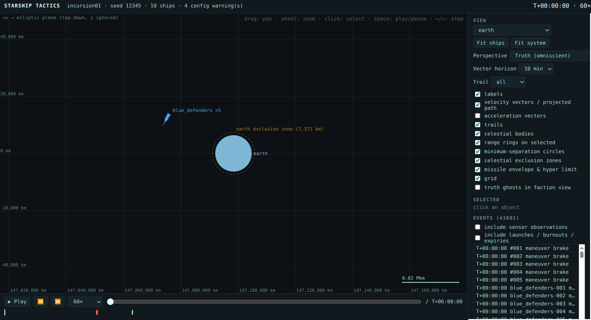

# starshiptactics

Deterministic tactical space-combat simulation and visualization project.



Start with [`SPEC.md`](SPEC.md).

The current design intentionally makes the core physics/navigation/sensor simulator implementable before canon-specific combat numbers are settled.

Useful files:

- `SPEC.md` — authoritative architecture and milestone definition
- `systems/solar_system.yaml` — reusable Solar System environment
- `classes/ships.yaml` — reusable ship class schema/example
- `classes/missiles.yaml` — missile and graser schema/examples
- `rules/navigation.yaml` — safety/navigation rules
- `rules/simulation.yaml` — deterministic simulation defaults/constants
- `rules/doctrine.yaml` — initial doctrine hooks
- `scenarios/example_engagement/`, `scenarios/earth_orbit/` — example scenarios (the latter shows orbits)
- `docs/MISSIONS.md` — group missions: detection, reaction rules, engage / withdraw / objective stack
- `scenarios/incursion01/`, `scenarios/incursion02/` — fleet engagements (the latter shows a cautious defender withdrawing)
- `scenarios/incursion03/` — an arrival from hyperspace at the hyper limit, with its film shot lists
- `docs/RENDER.md` — cinematic renders with Blender: shot lists, previews, render farms
- `docs/OPEN_QUESTIONS.md` — values intentionally left unresolved

## Running

## Layout

The checkout is source only. Everything in it is needed to rebuild, and nothing that is built is kept in it.

```
scenarios/<id>/scenario.yaml     a scenario; the folder name is its id, and that id is its name in every command
scenarios/<id>/shots/<film>.yaml shot lists: the films made from that scenario
classes/  rules/  systems/       ship and missile classes, rules, star systems (shared by all scenarios)
images/                          reference art; the placeholder hulls and their textures are built from it
simulator/  viewer/  tests/      code
```

Runs, frames, Blender files and films go to a working directory outside the checkout: `~/starshiptactics-work`, or
`$STARSHIP_WORK`, or `--work DIR` before the command. All of it can be deleted and rebuilt.

```
<work>/runs/<id>/                      a simulation run: state, missiles, events, metadata, report
<work>/renders/<id>/<film>[.<profile>]/  shot data, the Blender scene, frames, a render-farm bake
<work>/films/<id>_<film>[.<profile>].mp4 finished films
```

From a fresh clone, one command rebuilds a film: it runs the simulation if there is no run yet, or if the scenario,
its data files or the simulator's code have changed since the stored run, and then renders.

```bash
python -m simulator render incursion03/arrival --profile preview    # small and quick; drop --profile for the full film
python -m simulator where                                           # the working directory and what is in it
```

## Running

```bash
python -m simulator validate example_engagement
python -m simulator run example_engagement             # writes <work>/runs/example_engagement/ (~45 s)
python -m simulator serve example_engagement           # tactical viewer at http://localhost:8000/viewer/
python -m simulator report incursion01                 # after-action analysis -> report.html in the run (self-contained)
python -m unittest discover -s tests -t .
```

A scenario is named by its id; a path to a scenario file also works (`run`, `validate`).

Requires Python 3, PyYAML and NumPy. `viewer/index.html` is a read-only tactical plot (play/pause, speed,
scrub, pan/zoom, follow, trails, vectors, light-delayed faction tracks); it can also load the three output files
by file picker or drag-and-drop.

`report` needs no extra packages: it writes one HTML file with inline charts (range, missiles, integrity, speed, tracks, who-shot-whom, miss distance) from the run's output files.

Milestone 1 is implemented. Simulator-side assumptions and limitations are in `docs/M1_NOTES.md`.
